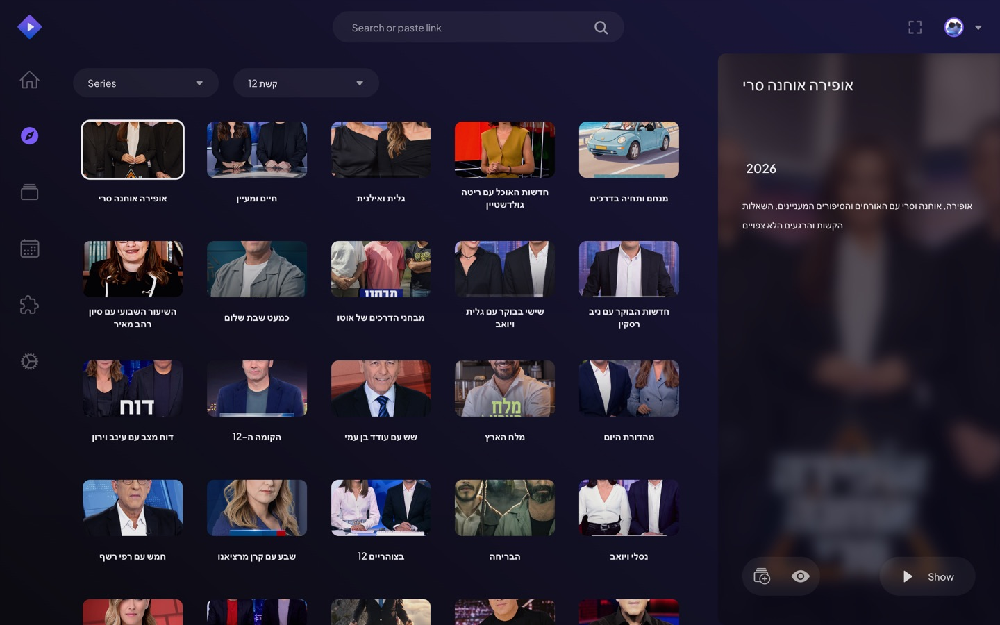
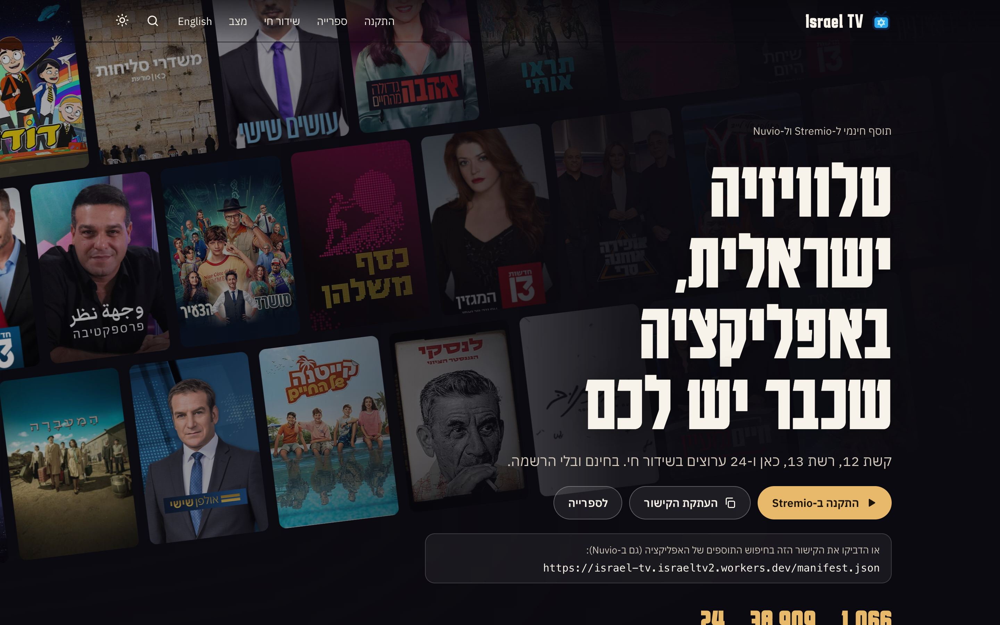
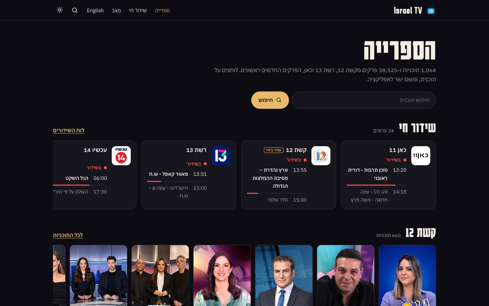
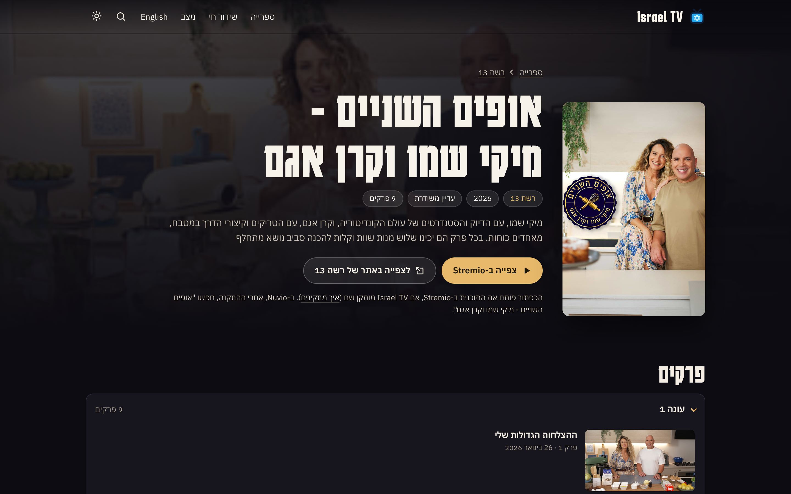
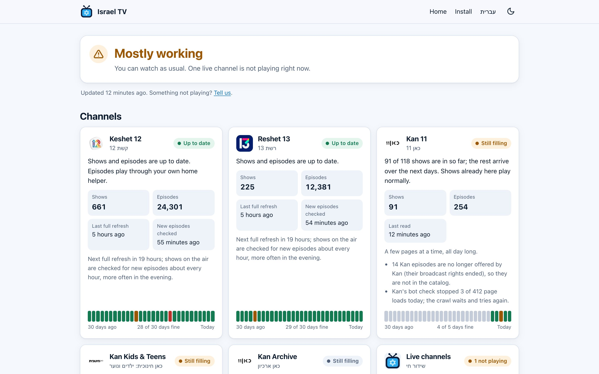

# Israel TV

**Keshet 12, Reshet 13, Kan and live Israeli channels in Stremio and Nuvio.** Free, no account, nothing to sign up
for. (Keshet 12, and some titles when you are abroad, need a little extra setup at home: see below.)

**[Install it from the website](https://israel-tv.israeltv2.workers.dev/)** ([בעברית](https://israel-tv.israeltv2.workers.dev/he/)) ·
**[Browse every show](https://israel-tv.israeltv2.workers.dev/library/)** ·
**[What's on live now](https://israel-tv.israeltv2.workers.dev/live/)** ·
**[Is everything working?](https://israel-tv.israeltv2.workers.dev/status)**

 



<p>
<a href="https://israel-tv.israeltv2.workers.dev/he/"></a>
<a href="https://israel-tv.israeltv2.workers.dev/library/"></a>
<a href="https://israel-tv.israeltv2.workers.dev/show/iltv_reshet_10/"></a>
<a href="https://israel-tv.israeltv2.workers.dev/status"></a>
</p>

The website shows the whole catalog (every show, its episodes, the live guide), but plays nothing itself: its
buttons open the show in Stremio or on the broadcaster's own site.

## Install

Copy this link — it is the whole install:

```
https://israel-tv.israeltv2.workers.dev/manifest.json
```

- **Stremio:** [Install in Stremio](https://web.stremio.com/#/addons?addon=https%3A%2F%2Fisrael-tv.israeltv2.workers.dev%2Fmanifest.json)
  (opens Stremio's website; signed in, it appears in all your Stremio apps) — or in the app open _Addons_, paste the
  link into the search box and choose _Install_.
- **Nuvio:** _Settings → Addons → Add addon_, paste the link.

Tip for TVs: install it on your phone or computer, signed in to the same Stremio account — it then appears on the TV
too.

**Added it before 7 November 2026?** Remove Israel TV from your addons and add the link again (and the home helper's
link, if you use one). This is needed once; what you have watched and where you stopped stay as they are.

You will see new rows: **קשת 12**, **רשת 13**, **כאן 11**, **כאן חינוכית: ילדים ונוער**, **כאן ארכיון** and **שידור חי**
(live).

- **In Israel**, the link alone plays everything except Keshet 12.
- **Abroad**, the link alone plays most of Reshet 13, the Kan titles the broadcaster allows abroad and most live
  channels. Anything that plays only from Israel says so: **זמין לצפייה רק בישראל**.
- **Keshet 12** shows have no play option until you add the [home helper](#want-keshet-12-mako).

## What you get

Shows in Hebrew, newest episode first, with search and show pages. Your watch progress stays put: episodes keep
their numbers for good.

| Channel                                                                                                                                              | What     | In Israel                | Outside Israel                                           |
| ---------------------------------------------------------------------------------------------------------------------------------------------------- | -------- | ------------------------ | -------------------------------------------------------- |
| Reshet 13                                                                                                                                            | Episodes | ✅ plays                 | ✅ most play; a few say "only in Israel"                 |
| Kan 11, Kan Kids & Teens, Kan Archive                                                                                                                | Episodes | ✅ plays                 | some titles play, the others say "only in Israel"        |
| Keshet 12 (Mako)                                                                                                                                     | Episodes | 🏠 needs the home helper | 🏠 needs the home helper                                 |
| Live: Kan 11, Kan Educational, Makan 33, 13, 14, Knesset, i24 (4 languages), ynet, Calcala 10, Channel 9, 13's comedy, vacation and reality channels | Live     | ✅ plays                 | ✅ plays (a stream refused abroad says "only in Israel") |
| Live: Keshet 12, 24, Eretz Nehederet, Savri Maranan, Keshet's comedy, drama, music and food channels                                                 | Live     | 🏠 needs the home helper | 🏠 needs the home helper                                 |

Live channels show what is on now and next. Apps that have a TV-guide screen (some Stremio versions; Nuvio has none yet) also get the full programme
guide of Keshet 12, Reshet 13, Kan 11, Kan Educational, Makan 33, Channel 14 and the Knesset. Keshet 12, Kan 11 and the
Knesset also have a captioned stream ("כתוביות"). Some channels have a spare stream marked "גיבוי" (backup): try it
when the first one does not play.

Some titles **only play from Israel** — that is the broadcaster's choice, not the app's.

## Want Keshet 12 (Mako)?

Keshet 12 only lets a video play when your own home internet asks for it. So Keshet 12 needs a small **home helper**:
a little program on a computer that stays on at home (a desktop PC or Mac, a storage box or a Raspberry Pi), which you
add to your app as a second link. So the whole install is two links: the public one above, and one helper link.
Setting it up takes 15 minutes to an hour the first time, and that computer has to stay on:
**[Set up the home helper](docs/setup/home-helper.md)**. You can also ask an AI assistant to do it for you:
[a guide written for assistants](docs/setup/for-agents.md).

The helper link comes in two kinds; install one of them, on the account all your devices share:

- **Home only** (the easy way): its home-network link. It plays at home; on a phone outside the house the helper's
  sources do not play.
- **Home and away**, with a Cloudflare Tunnel (needs a domain of your own and some technical setup): its tunnel link
  instead. At home it plays everything the home-only link does; away it plays Keshet 12. No video goes through the
  tunnel. **[The helper through a Cloudflare Tunnel](docs/setup/tunnel.md)**.

## Watching from abroad?

Everything in the catalog shows up anywhere, most live channels and most of Reshet 13 play anywhere, and so do the Kan
titles the broadcaster allows abroad. Keshet 12 plays with the home helper on your home network, wherever in the world
your home is. A stream that plays only from an Israeli internet connection says so in the app: **זמין לצפייה רק
בישראל** (only in Israel). The home helper can fetch those for you through a VPN or proxy service with an Israeli
location (a paid service you may already have); those titles then show a second source called **דרך החיבור הישראלי שלך** (via your Israeli connection) —
pick that one. See
[Watching from abroad](docs/setup/home-helper.md#watching-from-abroad). You only need this if you live outside
Israel.

## Questions

- **A new episode is not there yet.** New episodes usually appear within an hour or two of going online. Apps keep
  the rows for a while — pull down to refresh, or restart the app.
- **A row starts with ⚠.** That channel's site has not been read for a while; what you see is the last good list.
- **A row starts with ⏳.** That row is still filling (Kan's shows arrive over a few days); the item says how many
  are in so far.
- **Something does not play.** Check the [status page](https://israel-tv.israeltv2.workers.dev/status) (it says in plain words
  what works and what does not), then
  [report it](https://github.com/israeltv2/israel-tv/issues/new?template=broken-source.yml) with the show and episode.
- **Search finds nothing.** Search in Hebrew, as the channel writes the title. Many well-known shows can also be
  found by their English name.
- **Does it work with my other addons?** Yes. When you open an Israeli show from another addon's rows (such as
  Stremio's own), Israel TV adds its episodes there too if it knows that show and its seasons are numbered the same.
  It never touches movies. (Details for addon users: it answers its own `iltv_` ids, and `tt`/`tmdb:` series ids
  matched to its shows.)
- **You own something shown here and want it removed?** Write to israeltv2@proton.me with what it is; see
  [removal requests](docs/takedown.md).
- **Is it maintained?** It is in beta and runs every day. When a channel's site changes, its row shows ⚠ until the
  reading is fixed; reports help.

## How it works

```
 the broadcasters' sites ──▶  reader  ──▶  catalog (the link you installed)  ◀──  your app
                                                                                     │
                                    home helper (Keshet 12; Israel-only titles)  ◀───┘
```

- **The reader** visits the broadcasters' public sites slowly and keeps every show and episode under a permanent
  number.
- **The catalog** is what your app talks to: the rows, show pages, search, and links to the broadcasters' own
  video.
- **The home helper** does the little that has to happen on your own internet: getting Keshet 12's permission to play, and fetching
  Israel-only video through an Israeli connection.

The video always comes from the broadcasters themselves. More: [How Israel TV works](docs/architecture.md).

## Run your own copy

Anyone can run the whole thing — at home, or on a free Cloudflare account to share with family and friends. Start
at [Choose your setup](docs/setup/README.md).

## Contributing

Bug reports, fixes for a channel whose site changed, and new channels are welcome: see
[CONTRIBUTING.md](CONTRIBUTING.md). Security issues: [SECURITY.md](SECURITY.md).

## Privacy

No accounts and no tracking. The public link counts plays anonymously (a device is counted by a code that changes
every day and cannot be turned back into an address). Israel TV hosts no video: it points your app at the
broadcasters' free public services. [Details](docs/privacy.md).

## License

[AGPL-3.0](LICENSE), © 2026 Israel TV contributors. If you run a modified copy as a service for others, publish
your changes too. Respect the broadcasters' terms where you live.
